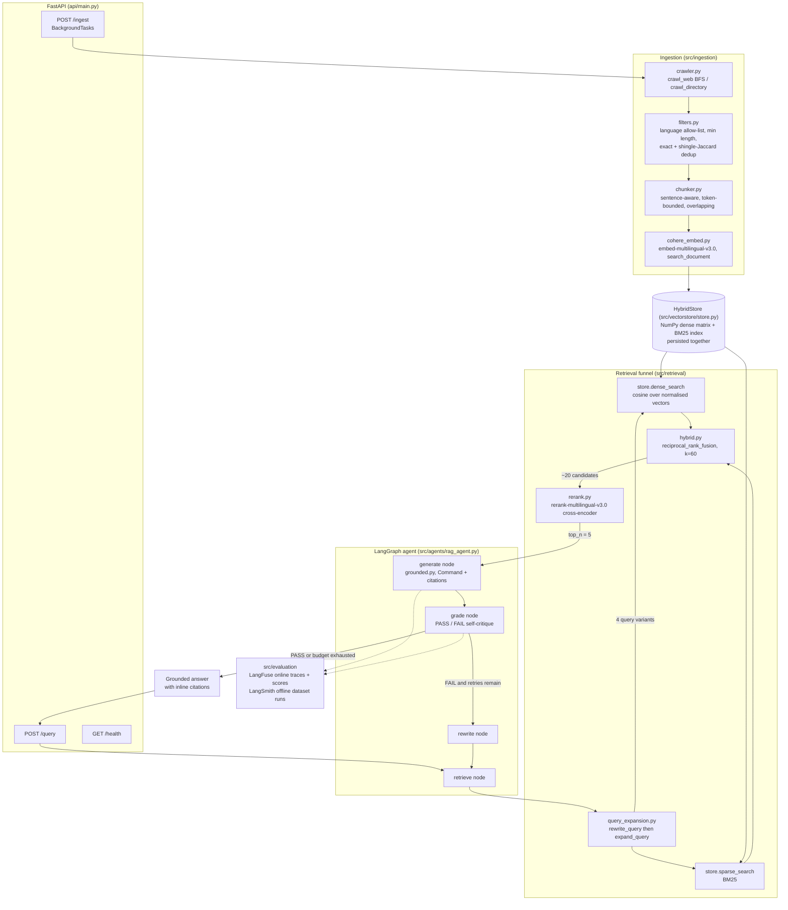

# Babel

Multilingual semantic search & RAG platform built on Cohere **Command / Embed / Rerank**. Crawls and filters a multilingual corpus, serves **hybrid retrieval (dense + BM25)** with a Cohere **Rerank** cross-encoder stage, and answers questions with **grounded Cohere Command generation and inline citations** — wrapped in an agentic self-correction loop and evaluated end-to-end with LangSmith and LangFuse.

## Overview

- **Ingestion** — polite BFS web crawler + local-directory loader, boilerplate stripping (`crawler.py`)
- **Filters** — language detection / allow-listing, min-length quality gate, exact + near-duplicate (shingle-Jaccard) removal (`filters.py`)
- **Chunking** — semantic, sentence-aware chunking with token-bounded windows and configurable overlap, multilingual-friendly (`chunker.py`)
- **Embeddings** — Cohere `embed-multilingual-v3.0`, asymmetric `search_document` / `search_query` input types, batched (`cohere_embed.py`)
- **Hybrid store** — NumPy cosine dense index + BM25 lexical index over one corpus, persisted together (`store.py`)
- **Retrieval** — query rewriting + multi-query expansion → dense+BM25 search fused with Reciprocal Rank Fusion → Cohere `rerank-multilingual-v3.0` cross-encoder → top-n (`query_expansion.py`, `hybrid.py`, `rerank.py`)
- **Generation** — grounded Cohere `command-r-plus` answers with structured inline citations back to source documents (`grounded.py`)
- **Agent** — LangGraph `retrieve → generate → grade → (rewrite → retrieve …)` self-correction loop (`rag_agent.py`)
- **Evaluation** — LangFuse online tracing + faithfulness/relevance scoring; LangSmith offline dataset runs (`evaluation/`)
- **FastAPI** — `/query`, `/ingest` (background), `/health`; shipped on Docker with GitHub Actions CI/CD

## Tech Stack

Python 3.11 · Cohere (Command / Embed / Rerank) · LangGraph · LangSmith · LangFuse · rank-bm25 · NumPy · FastAPI · BeautifulSoup · langdetect · Docker · GitHub Actions

## Quickstart

```bash
pip install -r requirements.txt
export COHERE_API_KEY=...

# Ingest a corpus (web seeds or a local directory)
CONFIG_PATH=configs/config.yaml uvicorn api.main:app --reload

curl -X POST http://localhost:8000/ingest \
  -H "Content-Type: application/json" \
  -d '{"seeds": ["https://example.com/docs"], "max_pages": 50}'

# Query (multilingual: ask in any language, retrieve across all)
curl -X POST http://localhost:8000/query \
  -H "Content-Type: application/json" \
  -d '{"question": "¿Cómo funciona la búsqueda híbrida?"}'

# Tests
pytest tests/
```

Or with Docker:

```bash
COHERE_API_KEY=... docker compose up --build
```

## Architecture





The funnel is where the interesting work happens: `retrieve()` rewrites the
question, expands it into several variants, runs each variant through **both**
indexes, fuses all those rankings with RRF, and only then pays for a
cross-encoder pass over the surviving candidates. The agent wraps that funnel in
a loop bounded by `max_iterations` (default 3), so a failed grade costs at most
two extra retrieval rounds.

## Project Structure

```
babel/
├── src/
│   ├── clients.py          # Cohere client wrapper + response normalisation
│   ├── ingestion/          # crawler.py, filters.py, chunker.py, pipeline.py
│   ├── embeddings/         # cohere_embed.py (multilingual)
│   ├── vectorstore/        # store.py (dense + BM25 hybrid)
│   ├── retrieval/          # query_expansion.py, hybrid.py (RRF), rerank.py
│   ├── generation/         # grounded.py (Command + inline citations)
│   ├── agents/             # rag_agent.py (LangGraph self-correction loop)
│   └── evaluation/         # langfuse_eval.py, langsmith_eval.py
├── api/                    # main.py (FastAPI)
├── configs/                # config.yaml
├── tests/                  # pytest suite (chunker, filters, hybrid store + RRF)
├── Dockerfile · docker-compose.yml
└── .github/workflows/ci.yml
```

## Tests

```bash
pytest tests/ -v
```

The offline suite covers the pieces that don't need a Cohere key: semantic chunking (token budget, overlap, metadata propagation), corpus filters (length gate, exact dedup, language allow-listing), and the hybrid store (dense cosine ordering, BM25 lexical match, RRF fusion, save/load round-trip). Cohere-backed paths (embed, rerank, Command generation, the agent loop) are exercised via the evaluation harness against a live key.

## Evaluation (RAG)

Run on a labelled `{question, gold_doc_ids, gold_answer}` set (~50 questions spanning multiple languages over the seeded corpus).

| Metric | How to compute |
|---|---|
| **Retrieval Recall@k** | Fraction of `gold_doc_ids` present in the fused top-k before rerank (k ∈ {10, 20}). `retrieval_recall()` in `langfuse_eval.py`. |
| **Rerank lift** | Recall / MRR after Cohere Rerank vs. before — isolates the cross-encoder's contribution. |
| **Cross-lingual recall** | Recall restricted to query/doc language pairs that differ, to verify the shared multilingual space. |
| **Faithfulness** | LLM-judge (Command) over `(retrieved passages, answer)`; report % faithful. Implemented in both eval harnesses. |
| **Answer relevance** | LLM-judge on `(question, answer)`; mean score and % ≥ 0.8. |
| **Citation precision** | Of the documents the answer cites inline, fraction actually in `gold_doc_ids`. |
| **Self-correction rate** | Share of queries that triggered a rewrite loop, and recall/faithfulness delta after the extra round. |
| **Latency p50 / p99** | End-to-end `/query` time; LangFuse spans break it into expand / retrieve / rerank / generate. |
